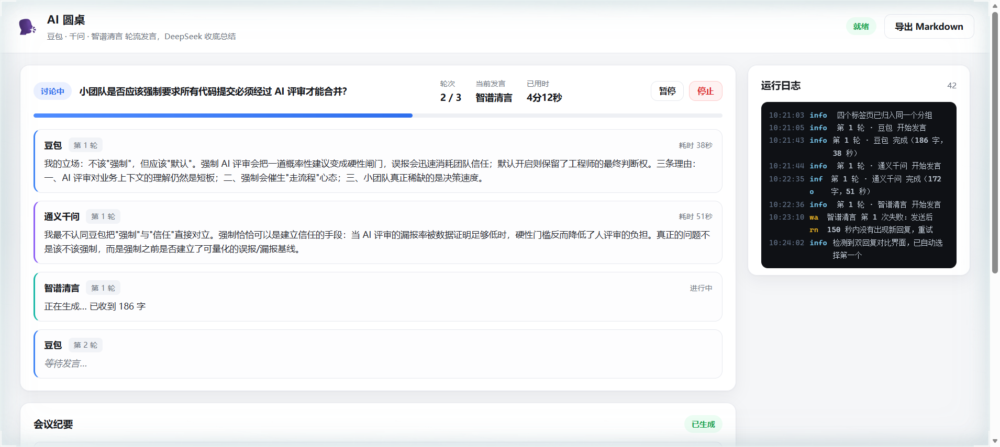

# AI 圆桌 · 多模型辩论扩展

> 三个臭皮匠，顶个诸葛亮。
>
> 给定一个议题和轮数，扩展自动驱动**豆包 / 通义千问 / 智谱清言**在你的浏览器里轮流辩论，
> 最后由 **DeepSeek** 汇总成一份结构化会议纪要。

不是各问一遍再人工比对，而是**真的在讨论**：每一轮每个人都能看到前面所有人说过的话，
并且被强制要求**先指出别人的问题，再立论**。



---

## 它解决什么问题

单问一个模型，答案往往片面且没有对照。手工把同一个问题在四个网页里复制粘贴、再人工汇总，
一轮就要 15–25 分钟，还不可复现。

这个扩展把整个过程自动化：

- 给定议题与轮数 → 点「开始讨论」
- 四个标签页自动打开、归入同一个标签组
- 每轮按 **豆包 → 千问 → 智谱清言** 顺序发言，每次发言前把前面的讨论内容注入输入框
- 全程自动等待流式输出、抓取正文、失败重试、超时兜底
- 最后由 DeepSeek 读完整份记录，输出结构化纪要
- 一键导出 Markdown

---

## 安装

扩展必须先打包加载（浏览器不允许网页静默安装扩展）。

**Windows 一键**：双击 `install.bat`，按窗口提示操作即可。

**手动三步**：

1. 打开 `edge://extensions/`（Chrome 为 `chrome://extensions/`）
2. 打开左下角 **「开发人员模式」**
3. 点 **「加载解压缩的扩展」**，选择本仓库根目录

安装后，浏览器工具栏出现图标，点击即可打开控制台。

### 前置条件

- Edge / Chrome 116 及以上
- 已登录：豆包、通义千问（chat.qwen.ai）、智谱清言、DeepSeek
- 首次使用前，确认四个页面都能正常对话

---

## 使用

1. 点工具栏图标打开控制台
2. 点「检查四家状态」，四个站点都显示 **就绪（前台）** 或 **后台标签页** 即可
3. 填议题（越具体、带约束条件越好）
4. 设定轮数（1–20，实时显示预计耗时）
5. 点「开始讨论」
6. 结束后点右上角「导出 Markdown」

> **使用时不要最小化浏览器窗口。** 扩展会在每次发言前自动把对应标签切到前台；
> 但如果整个窗口被最小化，Chrome 会把页面降频，有些站点会收不到输入。

---

## 它是怎么工作的

```
┌──────────────────────────────┐
│ 控制台页面（扩展页，永不回收）│  ← 编排引擎 + UI
└──────────────┬───────────────┘
               │ chrome.tabs / chrome.tabGroups / chrome.scripting
               ▼
┌──────────────────────────────┐
│ 四个内容脚本（各站一套）      │  ← 注入、发送、等待、抓取
└──────────────┬───────────────┘
               │ DOM
               ▼
        豆包 · 千问 · 智谱 · DeepSeek
```

三个关键设计：

**1. 编排跑在扩展页面，不跑在 service worker**
MV3 的 service worker 会被浏览器随时回收，而一次发言要等几十秒到几分钟。
扩展页面（控制台标签）生命周期与标签页一致，并且同样拥有完整的 `chrome.*` 权限。

**2. 所有等待逻辑放在内容脚本**
控制台在等待时会被切到后台（因为发言的标签被切到前台），定时器会被降频。
所以超时、稳定判定、轮询全部在**当前活跃标签页**的内容脚本里执行。

**3. 发言前主动聚焦**
每次发言前调用 `chrome.windows.update({focused:true})` + `chrome.tabs.update({active:true})`。
这是浏览器扩展相对外部自动化方案的决定性优势——它能让页面真正"活"过来。

---

## 回复完成的判定

网页版聊天没有"生成结束"事件，只能用启发式组合判断。本项目的判定栈：

1. 最后一条回复的正文与发送前不同（新回复已出现）
2. 正文连续 4 秒没有变化
3. 正文不匹配已知中间态（`正在思考…` / `搜索中…` / `你更喜欢哪个回复` / `回复 1` …）
4. 正文以句末标点结尾（`。！？…`）；若没有，则等满 15 秒再接受，避免卡死
5. 450 毫秒后二次确认，文本仍然一致才采纳

任一条件不满足就继续等待，直到超时。这套判定有 9 个确定性单元测试覆盖
（见 `test/waiter.test.mjs`）。

---

## 可靠性

| 机制 | 说明 |
| --- | --- |
| 失败重试 | 每条发言最多 2 次，重试前清空输入框 |
| 单条超时 | 300 秒 |
| 首包超时 | 发送后 150 秒无新回复 → 判定失败并重试 |
| 输入校验 | 填充后核对编辑器实际长度 + 发送按钮是否仍禁用，不一致就重填 |
| 页面无响应 | 连续 3 次读取失败立即抛错（`E_UNRESPONSIVE`），不耗满超时 |
| 汇总硬预算 | 汇总阶段总预算 420 秒，超时自动降级为「原始发言整理稿」 |
| 连续失败熔断 | 连续 3 条发言失败判定为系统性故障，终止并报错 |
| 全程日志 | 控制台右侧实时日志，含每个站点的进度与错误码 |

---

## 各站点的实现差异

| 站点 | 编辑器 | 发送方式 | 备注 |
| --- | --- | --- | --- |
| 豆包 | ProseMirror（需先点击聚焦） | 点击发送按钮 | 消息列表虚拟滚动，不能用条数判断新回复 |
| 通义千问 | textarea | 点击发送按钮 | 会触发「双回复对比」实验界面，已自动选择 |
| 智谱清言 | textarea | 回车 | 回复带联网引用标记，已自动清理 |
| DeepSeek | textarea | 圆形发送按钮 | 汇总前会关掉「深度思考 / 智能搜索」 |

站点改版时，只需要修改 `src/sites.js` 里对应站点的选择器，其它代码不用动。

---

## 已知限制

- **必须手动加载扩展**：浏览器不允许程序化安装扩展，这是安全边界。
- **不要最小化窗口**：最小化后 Chrome 会降频页面，部分站点可能收不到合成输入。
- **站点改版会导致适配器失效**：这是网页自动化无法消除的固有成本，修复方式见上一节。
- **千问最不稳定**：它的双回复对比界面与偶发卡顿来自站点自身，扩展只能兜底不能根治。
- **单场耗时**：3 轮 × 3 人约 10–15 分钟，这是四家真实网页版的固有速度。

---

## 隐私与免责

- 扩展只在你本机运行，不向任何第三方服务器发送数据（也没有这类代码）。
- 会议内容会通过你自己已登录的会话发送到豆包 / 千问 / 智谱 / DeepSeek 的服务器。
- 不要用本扩展处理敏感信息。
- 本项目通过模拟用户操作驱动各家网页版，可能不符合其服务条款。请自行评估风险，
  仅供个人学习与研究使用。

---

## 开发

```bash
npm test          # 单元测试（18 项）
npm run check     # 静态检查：manifest / 语法 / 资源引用 / HTML 元素
npm run icons     # 重新生成图标
```

### 调试通道

`tools/` 下有一套调试脚本：把 `src/sites.js` + `src/waiter.js` + `src/agent.js`
**原样注入**真实页面并驱动，用来在加载扩展之前验证选择器与等待逻辑。

```bash
node tools/dom-smoke.mjs                          # 只读检查四家选择器
node tools/live-test.mjs zhipu "用一句话回答：1+1" 120   # 真实跑一轮
```

这类脚本依赖本地运行的 [Kimi WebBridge](https://www.kimi.com/features/webbridge)，
**扩展本身不依赖它**。

---

## 目录结构

```
manifest.json          扩展清单（MV3）
src/
  sw.js                service worker：打开控制台
  dashboard.html/css/js 控制台 + 编排引擎
  core.js              提示词构造、Markdown 导出（可单测）
  waiter.js            回复完成判定（可单测）
  sites.js             四个站点的选择器与交互配置
  agent.js             内容脚本：注入、发送、抓取
test/                  单元测试
tools/                 图标生成、静态检查、调试脚本
docs/                  截图与样例
install.bat            Windows 安装助手
```

## License

MIT
